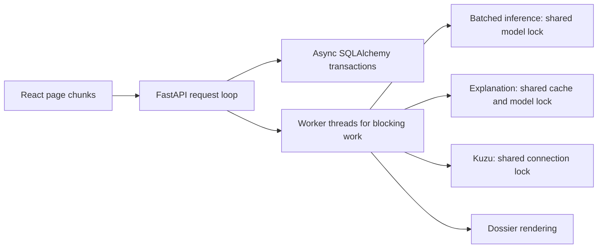

# Architecture and performance improvements

Implemented on 11 October 2026. The application remains a single FastAPI service
with an embedded graph database and a React frontend. These changes address the
measured request paths without introducing new infrastructure.

## Measurements

| Measure | Before | After | Scope |
| --- | ---: | ---: | --- |
| Score 1,645 drugs | 281.383 ms | 23.404 ms | Existing local MLP checkpoint, warm CPU inference |
| Candidate persistence lookup queries | Up to 40 | 2 | One batch of 20 candidates |
| Initial frontend JavaScript | 378.16 KB | 302.18 KB | Production build, uncompressed |
| Initial frontend JavaScript, gzip | 109.53 KB | 95.97 KB | Production build |

The checkpoint benchmark compared the original service at commit
`2be8770efe637a324e5a31c5d2f9dbe395f9d7ee` with the modified service, using the same
local checkpoint and disease embedding. Both paths were warmed, then timed in
alternating order for five repetitions. Medians above use PyTorch 2.11.0 CPU with
one compute thread and a batch size of 64. The largest probability difference was
`1.1920928955078125e-07`; the top 20 candidate set was unchanged. This is about 12×
faster model scoring under those conditions, not a claim about full request
latency, other machines, cold starts, or scientific model quality.

The repeatable synthetic benchmark also exercised both architectures with 128
drugs, five repetitions, and one CPU thread. Batch size 64 versus batch size 1
measured 25.82× for the MLP and 15.62× for the GNN. The largest probability error
was below `1e-6`. Synthetic GNN inputs use aspirin-sized molecular graphs;
larger molecules and different checkpoints need their own measurements.

## Request architecture



Candidate scoring now runs bounded batches through either supported model. The
GNN uses the existing disconnected-graph batching helper, including edge offsets
and graph membership. The MLP stacks fingerprints and expands one disease
embedding over each batch. Temperature calibration, confidence intervals, and
descending score ordering are retained. Inference mode avoids gradient tracking.
An explicit empty drug selection returns no scores; an omitted selection scores
all available drugs. Scoring a disease on a fresh service loads the checkpoint
before resolving its embedding.

The shared indication service serializes loading and scoring with a reentrant
lock. Singleton creation is protected separately. This avoids duplicate loads
and concurrent access to model state and molecular feature caches.

Model inference, explanation initialization and generation, and dossier rendering
run in worker threads. Graph endpoints use synchronous FastAPI handlers so Kuzu
queries also run in worker threads. Kuzu initialization and shared connection use
are protected by locks; query results are fully materialized while holding the
connection lock. Explanations use a lock around generation and cache updates to
prevent duplicate work and inconsistent cached inputs.
Safety and dossier service initialization is also protected against concurrent
worker requests.

Candidate persistence prefetches existing score and evidence rows with two
queries, flushes parent rows together, and commits evidence in the same
transaction. SQLite retains `BEGIN IMMEDIATE` to serialize competing writes.
Full evidence, stable candidate IDs, update behavior, and rollback semantics are
preserved. Empty batches avoid opening a transaction.

The dashboard remains in the initial frontend bundle. Six other pages load on
demand with a loading status inside the existing layout. Browser downloads for
those pages happen on navigation; the reduction above describes the initial
download rather than total code across all pages.

Shutdown closes an initialized graph service and disposes the async database
engine. Database disposal also runs if graph cleanup fails.

## Configuration and verification

`INFERENCE_BATCH_SIZE` defaults to 64 and accepts environment values from 1 to
1024. Reduce it if large molecules cause memory pressure; measure changes before
increasing it. No retraining or database migration is required.

From `prototype/backend/`, using an environment with the backend dependencies:

```powershell
python -m pytest --cov=app --cov-report=term-missing --cov-fail-under=80
```

From `prototype/frontend/`:

```powershell
npm run build
npm run lint
```

From the repository root, run the synthetic benchmark:

```powershell
python prototype/scripts/benchmark_inference.py --drugs 128 --batch-size 64 --repeats 5 --threads 1
```

Validation: **297 tests passed, 84.97% coverage**; frontend build and lint passed.
Regression tests cover numerical equivalence across both architectures,
concurrent checkpoint loading, explicit drug selection, constant database lookup
count, full evidence persistence, competing writes, transaction rollback,
shutdown cleanup, and health requests completing while slow model, explanation,
graph, or dossier work is held open. A live server smoke check also returned
healthy status and searched the 4,357-disease catalog successfully.

New tests, the benchmark, and the modified inference and explanation services
pass Ruff with the backend configuration. Comparison against the original files
found no added Ruff findings in the other modified backend files. Repository-wide
backend lint still has pre-existing findings. Standard mypy validation is blocked
by invalid signatures in installed third-party `rdkit-stubs`.

## Remaining scaling limits

This change improves the prototype's measured paths. Worker threads keep blocking
work away from the async request loop, but they do not provide durable jobs or
unlimited parallel inference. The shared model and graph connection intentionally
serialize access. Very high concurrency can queue requests in the shared worker
pool. If sustained usage warrants it, the next architectural step is a dedicated
inference/job worker with bounded admission, cancellation, and progress reporting.

SQLite remains a single-writer store. PostgreSQL and a migration workflow become
useful when concurrent writes across processes become the bottleneck. Kuzu still
uses one connection; a measured per-worker connection design could improve graph
throughput. No production-load or GPU benchmark was performed. Existing safety
and literature paths, unbounded explanation-cache retention, and import-time
catalog loading remain candidates for a subsequent profiling pass.
